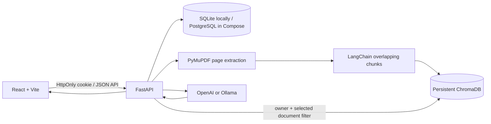

# StudyMind AI

**Learn Smarter with Artificial Intelligence**

StudyMind AI is a full-stack AI study workspace built around source-grounded learning. Upload selectable-text PDFs, ask questions against chosen sources with page citations, generate practice quizzes graded by the API, create saved revision notes, and review generated flashcards.

Project owner: Hanzala Inayat · BS Artificial Intelligence · University of Engineering and Technology Mardan

## Current Delivery

The current application includes:

- Registration, login, logout, password hashing, expiring JWTs in an HttpOnly cookie, and authenticated API routes.
- Private PDF upload, file-size/type checks, page-level PyMuPDF extraction, chunking, and processing-state reporting.
- Persistent Chroma embeddings with retrieval scoped to the authenticated user and selected documents.
- RAG chat with page citations, English/Urdu/Roman Urdu response selection, and saved conversation records.
- Source-grounded multiple-choice quiz generation, hidden answer keys, backend grading, and saved attempts.
- Source-grounded saved study notes and flashcard sets with persisted learned/needs-review status.
- Dashboard counts, recent documents, average quiz score, and activity derived from saved records.
- OpenAI and Ollama provider configuration, SQLite local setup, and PostgreSQL-compatible Compose setup.

This is an initial functional delivery, not yet the entire requested product. Subject management, rename, account deletion, richer summary/export controls, quiz and chat history UI, rate limiting, OCR, and broad frontend/backend test coverage remain follow-up work. Scanned PDFs with no selectable text are rejected with an explicit message. Do not present those features as implemented until they are added.

## Architecture



PDF text and vector metadata are tagged with user and document IDs. Retrieval filters on both values and selected document IDs. Uploaded text is passed as untrusted evidence, not as model instructions. The database stores chat and quiz records; Chroma and uploads are separate persistent data and must also be backed up.

## Local Setup (Windows)

Requirements: Python 3.11 or 3.12, Node.js 22 LTS, and optionally Docker Desktop. Open PowerShell in the repository root. The application code has also been syntax-checked under Python 3.14, but the supported local setup target remains Python 3.11/3.12.

1. Create and activate a virtual environment:

   ```powershell
   py -3.12 -m venv .venv
   .\.venv\Scripts\Activate.ps1
   ```

2. Install and configure the backend:

   ```powershell
   Set-Location backend
   python -m pip install -r requirements.txt
   Copy-Item .env.example .env
   ```

   Set `OPENAI_API_KEY` in `backend/.env`, or choose `AI_PROVIDER=ollama` and make sure Ollama is running with the configured chat and embedding models pulled. Keep keys in `.env`; never commit it. From the `backend` directory, `python -m pytest -q` runs the backend tests.

3. Apply migrations and run the API (in the `backend` directory):

   ```powershell
   alembic upgrade head
   uvicorn app.main:app --reload
   ```

   The API is at `http://localhost:8000`; interactive docs are at `http://localhost:8000/docs`.

4. In another PowerShell window, install and start the frontend:

   ```powershell
   Set-Location frontend
   npm install
   npm run dev
   ```

   Open `http://localhost:5173`. The browser uses a SameSite HttpOnly cookie for authentication; local development uses HTTP and therefore does not set the cookie's `Secure` flag. Production must use HTTPS.

## Docker

Copy the root environment template and set distinct random secrets before starting:

```powershell
Copy-Item .env.example .env
docker compose up --build
```

The frontend is served at `http://localhost:8080`, the API at `http://localhost:8000`, and Swagger at `http://localhost:8000/docs`. Compose uses PostgreSQL and named volumes for the database and the combined upload/Chroma data directory. Back up both volumes. On stateless hosting, attach durable database and vector/file storage or use managed equivalents; a container filesystem is not persistence. Change `CORS_ORIGINS` and `VITE_API_URL` for the deployed origin, and terminate HTTPS at a trusted proxy.

## Environment

Backend settings can be supplied as environment variables or in `backend/.env`. Important values include `SECRET_KEY`, `DATABASE_URL`, `CORS_ORIGINS`, `MAX_UPLOAD_MB`, `AI_PROVIDER`, provider credentials/model names, `CHUNK_SIZE`, `CHUNK_OVERLAP`, `RETRIEVAL_K`, and `JWT_EXPIRE_MINUTES`. Outside `ENVIRONMENT=development`, the API refuses the built-in development signing secret. Use a randomly generated secret with at least 32 random characters. Never place provider keys in frontend variables.

`AI_PROVIDER=openai` uses `OPENAI_API_KEY`, `CHAT_MODEL`, and `EMBEDDING_MODEL`. `AI_PROVIDER=ollama` uses `OLLAMA_BASE_URL`, `OLLAMA_CHAT_MODEL`, and `OLLAMA_EMBEDDING_MODEL`; the configured Ollama models must exist locally. Both chat and embedding calls require a reachable provider. Text extraction can identify image-only PDFs but OCR is not included.

## API Overview

- `POST /api/auth/register`, `POST /api/auth/login`, `POST /api/auth/logout`, `GET /api/auth/me`
- `GET /api/dashboard`
- `GET /api/documents`, `POST /api/documents`, `DELETE /api/documents/{document_id}`
- `POST /api/chat`, `GET /api/chat/sessions`
- `POST /api/quizzes`, `POST /api/quizzes/{quiz_id}/attempts`
- `GET /api/notes`, `POST /api/notes/generate`, `DELETE /api/notes/{note_id}`
- `GET /api/flashcards`, `POST /api/flashcards/generate`, `PATCH /api/flashcards/{card_id}`
- `GET /api/health`

Authenticated browser endpoints use an HttpOnly session cookie. API clients may also send `Authorization: Bearer <JWT>`. Quiz responses intentionally omit answer keys; attempts are graded on the backend.

## Tests and Builds

```powershell
Set-Location backend
python -m pytest -q
Set-Location ..\frontend
npm test
npm run build
```

The backend test suite covers authentication/session cookies, user-scoped document access and deletion, upload validation, PDF extraction and chunk metadata, retrieval filters and citations, deterministic quiz grading, and saved notes/flashcard ownership. Provider calls in AI-feature tests are mocked, so the tests do not require API credits. A frontend sign-in interaction test is included; the frontend test/build commands require Node.js and have not been run in environments without Node installed. Full browser and production-provider integration tests remain future work.

## Screenshots

Add genuine screenshots of the dashboard, library, tutor citations, and quiz review here after running the application with configured providers. No static product screenshots are included in this initial delivery.

## Security and Operations Checklist

- Replace all example secrets; set `ENVIRONMENT=production` and use HTTPS.
- Restrict CORS to the deployed frontend origin.
- Keep `.env` and uploaded files out of source control; restrict access to persistent volumes.
- Back up PostgreSQL, uploads, and Chroma data together and test restores.
- Set upload limits appropriate to the deployment and add reverse-proxy request limits/rate limiting before public exposure.
- Review provider data retention and privacy terms before uploading sensitive course or personal data.
- Rotate credentials after any suspected exposure.

## Portfolio Summary

**Resume:** Built StudyMind AI, a full-stack learning assistant using React, FastAPI, SQLAlchemy, PyMuPDF, LangChain, and ChromaDB. Implemented cookie-based authentication, user-isolated PDF ingestion and semantic retrieval, cited RAG answers, persistent quiz attempts, and deterministic API-side grading with OpenAI/Ollama provider configuration.

**LinkedIn:** Built StudyMind AI, a source-grounded study assistant that turns course PDFs into cited Q&A and practice quizzes. The application combines a responsive React interface with a FastAPI backend, per-user Chroma retrieval, persistent learning records, and support for hosted or local language-model providers.

## Future Improvements

Add subject organization and document rename; richer summarization/export controls; quiz and chat history interfaces; account export/deletion; rate limits and usage budgets; OCR for image-only PDFs; accessible end-to-end tests; and production observability and backup automation.

# hanzala_inayat